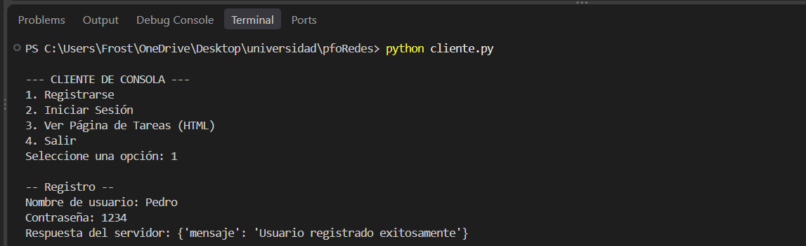
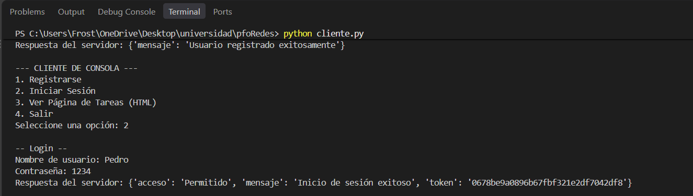
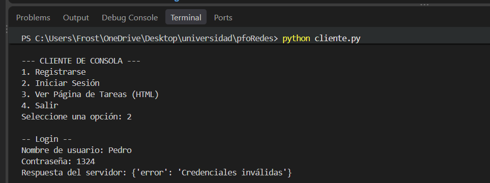
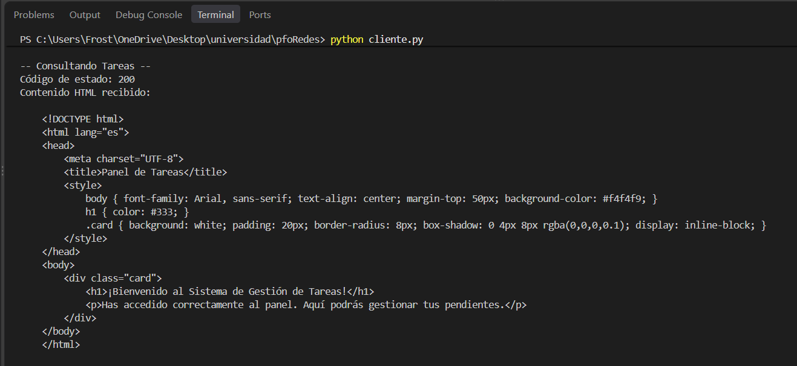
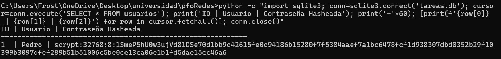

# 📝 PFO 2: Sistema de Gestión de Tareas con API y Base de Datos

## 👤 Información del Estudiante
- **Nombre:** Carlos Lovera
- **Curso:** Programacion de Redes Seccion "D"
- **Fecha:** Octubre 2026
- **Repositorio:** [Link a tu repositorio de GitHub]

---

## 📖 Descripción del Proyecto

API REST desarrollada con **Flask** que permite el registro de usuarios con contraseñas hasheadas, inicio de sesión con validación de credenciales y acceso a un panel de tareas. Los datos se persisten en **SQLite** y se incluye un cliente en consola para interactuar con la API.

**Objetivos cumplidos:**
- ✅ API REST con endpoints funcionales
- ✅ Autenticación básica con contraseñas hasheadas
- ✅ Persistencia de datos con SQLite
- ✅ Cliente en consola para interactuar con la API

---

## 🛠️ Requisitos Previos

- **Python 3.x**
- **Git**

### Instalación de dependencias

```bash
pip install flask requests
```

---

## 🚀 Instrucciones de Ejecución

### Paso 1: Clonar el repositorio

```bash
git clone https://github.com/Carloslovera/Proyecto-de-redes.git
```

### Paso 2: Iniciar el servidor (API)

Abre una terminal y ejecuta:

```bash
python servidor.py
```

El servidor se iniciará en `http://127.0.0.1:5000` y creará automáticamente el archivo `tareas.db`.

⚠️ **Importante:** Mantén esta terminal abierta.

### Paso 3: Usar el cliente en consola

Abre **otra terminal** (sin cerrar la del servidor) y ejecuta:

```bash
python cliente.py
```

Verás un menú interactivo para registrarte, iniciar sesión y consultar el panel de tareas.

---

## 📸 Capturas de Pantalla de Pruebas Exitosas

### Prueba 1: Registro de usuario exitoso


### Prueba 2: Inicio de sesión exitoso


### Prueba 3: Acceso denegado con credenciales incorrectas


### Prueba 4: HTML de bienvenida en GET /tareas


### Prueba 5: Base de datos SQLite con contraseñas hasheadas


---

## 💡 Respuestas Conceptuales

### ¿Por qué hashear contraseñas?

Hashear contraseñas es una medida de seguridad fundamental por las siguientes razones:

1. **Protección contra robo de datos:** Si un atacante accede a la base de datos, no podrá leer las contraseñas originales porque el hash es una función matemática **unidireccional** (no se puede revertir).
2. **Prevención de ataques de diccionario:** Librerías modernas como `werkzeug` añaden "sal" (salt) única a cada contraseña, protegiendo contra ataques de fuerza bruta y tablas arcoíris.
3. **Cumplimiento de buenas prácticas:** Nunca se deben almacenar contraseñas en texto plano, ya que viola principios básicos de seguridad.
4. **Verificación sin exposición:** El sistema puede verificar si una contraseña es correcta comparando hashes, sin necesidad de conocer la contraseña original.

### Ventajas de usar SQLite en este proyecto

1. **Cero configuración:** No requiere instalar ni configurar un servidor de base de datos independiente. Funciona directamente con un archivo local.
2. **Ligero y portátil:** Almacena toda la base de datos en un solo archivo (`tareas.db`), facilitando las pruebas y el despliegue.
3. **Ideal para prototipos:** Para una API de tareas con volumen de datos bajo, SQLite es suficiente y reduce la complejidad del proyecto.
4. **Integración nativa con Python:** SQLite viene incluido en la biblioteca estándar de Python, sin dependencias adicionales.
5. **Fácil de compartir:** Al ser un archivo único, es fácil compartir la base de datos para pruebas o demostraciones.

---

## 🌐 GitHub Pages

Este proyecto está documentado y disponible en GitHub Pages:

🔗 **URL de la documentación:** https://carloslovera.github.io/Proyecto-de-redes/

---

## 📂 Estructura del Proyecto

```
PFO2-Sistema-Tareas/
├── servidor.py          # API Flask + SQLite
├── cliente.py           # Cliente en consola
├── tareas.db            # Base de datos SQLite (se genera automáticamente)
├── README.md            # Este archivo
└── capturas/            # Carpeta con capturas de pantalla
    ├── registro_exitoso.png
    ├── login_exitoso.png
    ├── login_fallido.png
    ├── html_bienvenida.png
    └── base_datos.png
```

---

## 📝 Notas Técnicas

- **Framework:** Flask (Python)
- **Base de datos:** SQLite
- **Hashing:** werkzeug.security
- **Cliente HTTP:** requests

---

**Desarrollado por Carlos - Octubre 2026**